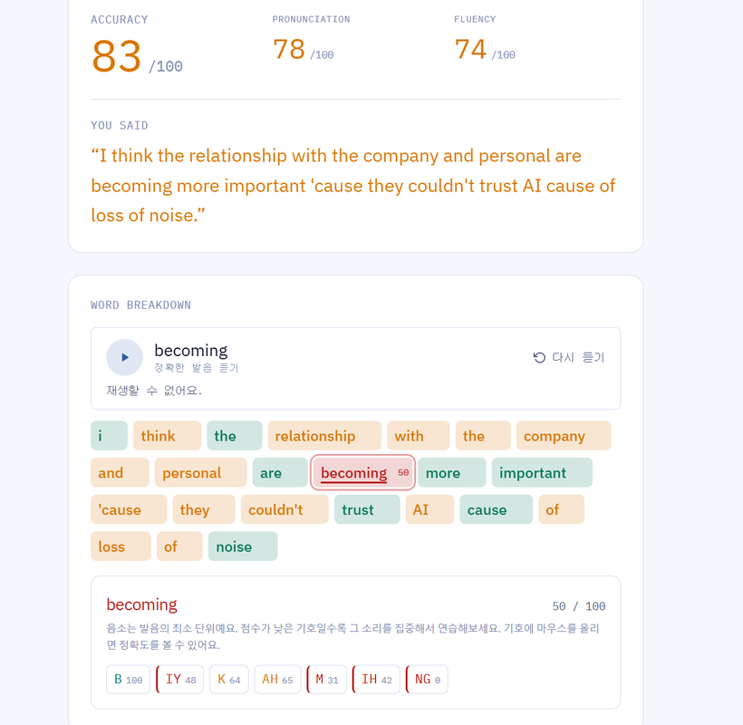
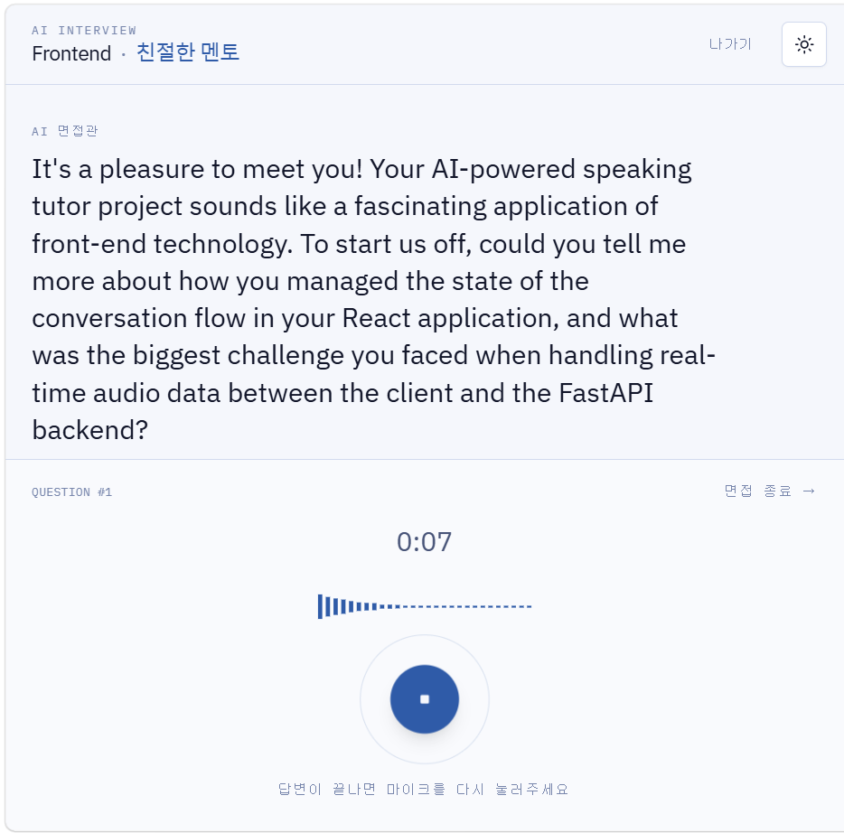
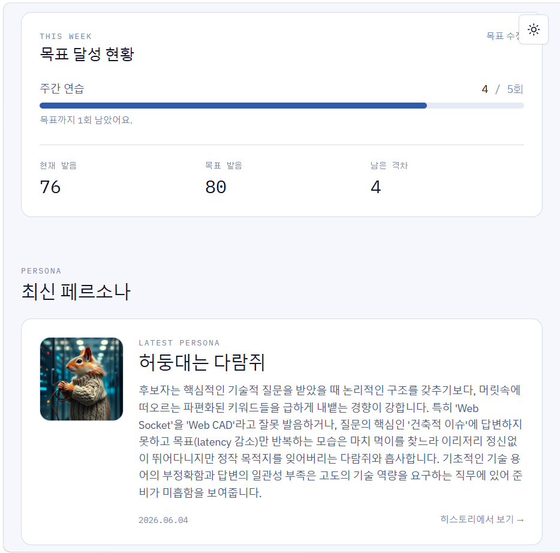
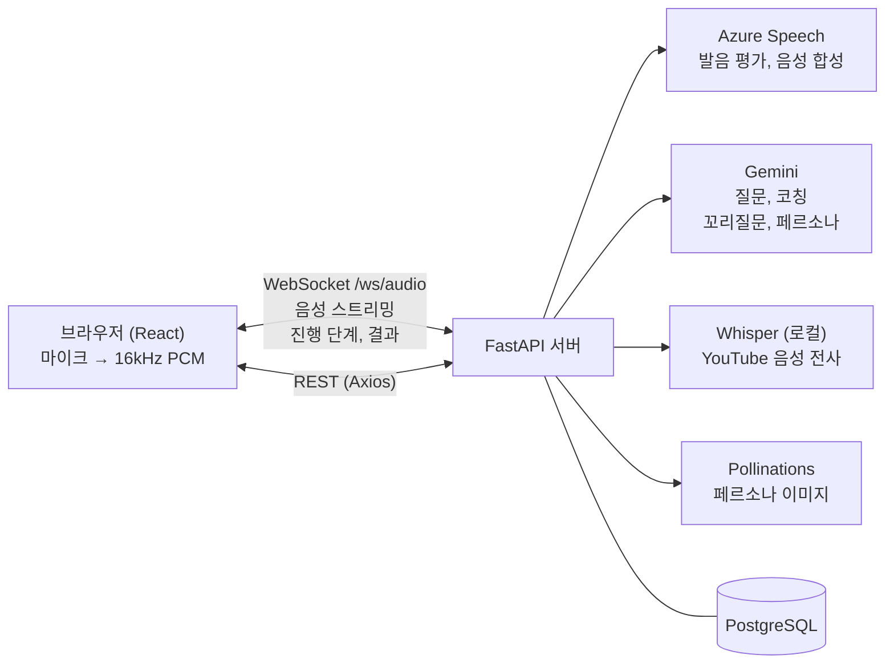

# EchoSync


보고 싶은 YouTube 영상으로 영어 회화를 연습하고, 지원 정보로 만든 영어 기술 면접에 대답하면 발음과 답변 내용을 함께 피드백받는 웹 서비스입니다.

동국대학교 정보통신공학과 2026년 1학기 캡스톤디자인 · 팀 싱크 (강상원, 안근한, 임낙원)

---

## 주요 화면

<table>
  <tr>
    <td width="50%" valign="top"><br><b>YouTube 스피킹 연습</b><br>영상 내용으로 만든 질문에 답변 녹음</td>
    <td width="50%" valign="top"><br><b>YouTube 연습 결과</b><br>정확도, 발음, 유창성 점수와 단어별 히트맵, 음소별 점수</td>
  </tr>
  <tr>
    <td valign="top"><br><b>AI 모의 면접</b><br>지원 정보로 만든 기술 면접 질문에 답변 녹음</td>
    <td valign="top"><br><b>대시보드</b><br>학습 목표와 최근 면접 페르소나</td>
  </tr>
</table>

---

## 프로젝트 소개

### YouTube 스피킹 연습

보고 싶은 영상의 URL을 넣으면 영상 내용으로 영어 회화 질문을 만들어 줍니다. 말로 답하면 단어별, 음소별 발음 점수와 답변 코칭이 나옵니다. 발음은 정해진 문장 없이 말한 그대로 평가합니다.

`영상 URL` → `음원 추출 (yt-dlp)` → `음성 전사 (Whisper)` → `질문 생성 (Gemini)`<br>
`답변 녹음` → `발음 채점 (Azure)` + `코칭 (Gemini)`

### AI 모의 면접

직무, 기술 스택, 경력 수준, 프로젝트 요약을 입력하면 입력한 내용에 맞춰 기술 면접 질문이 나옵니다. 자기소개서 PDF를 함께 올릴 수도 있습니다. 답할 때마다 발음 점수와 내용 코칭이 나오고, 방금 한 답을 바탕으로 꼬리질문이 이어집니다. 면접이 끝나면 전체 답변을 바탕으로 동물 페르소나 리포트를 만들어 줍니다.

`지원 정보` + `자기소개서 PDF (개인정보 마스킹)` → `질문 생성 (Gemini)`<br>
`답변 녹음` → `발음 채점 (Azure)` + `코칭과 꼬리질문 (Gemini)` → `페르소나 리포트`

### 학습 기록

대시보드에서 최근 답변의 점수 추이, 자주 틀리는 음소와 단어, 추천 연습 문장을 확인할 수 있습니다.

---

## 팀 구성

<table>
  <tr>
    <td align="center" valign="top" width="260"><a href="https://github.com/SangwonKang"></a><br><b>강상원</b><br><a href="https://github.com/SangwonKang">@SangwonKang</a><br><br><b>[Infra]</b><br>인프라, DB<br>회원 인증<br>대시보드와 추천 API</td>
    <td align="center" valign="top" width="33%"><a href="https://github.com/noswwan"></a><br><b>안근한</b><br><a href="https://github.com/noswwan">@noswwan</a><br><br><b>[Backend]</b><br>FastAPI<br>AI 연동<br>음성 처리 파이프라인</td>
    <td align="center" valign="top" width="33%"><a href="https://github.com/paraenjoy"></a><br><b>임낙원</b><br><a href="https://github.com/paraenjoy">@paraenjoy</a><br><br><b>[Frontend]</b><br>프론트엔드 전체<br>UI/UX 설계<br>백엔드 통합</td>
  </tr>
</table>

### 저장소 흐름

백엔드는 팀원 저장소에서 시작해 이 저장소로 합쳐졌습니다. 각 저장소의 원본 커밋 기록은 링크에서 볼 수 있습니다.

| 기간 | 저장소 | 내용 |
|---|---|---|
| 2026.05.02 ~ 05.09 | [noswwan/capstone_0502](https://github.com/noswwan/capstone_0502) | 첫 백엔드 프로토타입 (발음 평가, 질문 생성, YouTube 전사) |
| 2026.05.09 ~ 05.23 | [noswwan/sync_capstone](https://github.com/noswwan/sync_capstone) | 프로토타입을 옮겨 페르소나 이미지 생성, 질문별 피드백 추가 |
| 2026.05.14 ~ 05.26 | [SangwonKang/2026-Capstone-Project](https://github.com/SangwonKang/2026-Capstone-Project) | 프로토타입에 회원 인증, DB 모델, 대시보드와 추천 API 추가 |
| 2026.05.18 ~ 06.14 | EchoSync (이 저장소) | 두 저장소의 백엔드를 합치고 프론트엔드와 연동 |

통합한 뒤로는 한 계정으로만 커밋해서 이 저장소의 작성자는 한 명으로 나옵니다.

---

## 시스템 구성



**프론트엔드**

- 마이크 입력을 16kHz 모노 PCM으로 다운샘플링해 WebSocket으로 보냅니다. 서버가 인식, 채점, 코칭 단계마다 진행 상태를 알려 주면 화면에 지금 단계가 표시됩니다.
- 녹음 상태(대기, 연결, 녹음, 처리, 완료, 오류)는 훅 하나에서 관리합니다. 브라우저의 녹음 파일 저장이 끝나기 전에 서버 결과가 먼저 도착하면, 결과를 잠시 보관했다가 저장이 끝난 뒤 반영합니다.
- 결과 화면에서 단어를 누르면 음소별 점수가 나오고, 사용자가 말한 문장을 정확한 발음으로 합성한 음성에서 그 단어 구간만 골라 들려줍니다.
- 서버 데이터는 TanStack Query로, 로그인 정보와 테마 같은 화면 상태는 Zustand로 나눠 관리합니다.

**서버**

- Azure 음성 인식 호출은 블로킹되기 때문에 별도 스레드에서 실행합니다. 인식하는 동안에도 이벤트 루프가 멈추지 않습니다.
- 자기소개서 PDF는 외부 LLM으로 보내기 전에 이메일, 전화번호, 주민등록번호를 형식으로 찾아 가립니다. 이름과 주소는 '이름:', '주소:'처럼 항목명이 붙어 있을 때 가립니다.
- 면접 시작과 누적 분석 요청에서 Gemini 사용량 한도를 넘으면 503으로 응답하고, `Retry-After` 헤더에 재시도 시간을 담습니다.

---

## 기술 스택

| 영역 | 기술 |
|---|---|
| **Frontend** | React 18, TypeScript, Vite, Tailwind CSS, Zustand, TanStack React Query v5, React Router v6, Axios |
| **Backend** | Python, FastAPI, SQLModel / SQLAlchemy, PostgreSQL 16 |
| **AI / Speech** | Azure Speech SDK (발음 평가, 음성 합성), Google Gemini API, OpenAI Whisper (로컬), yt-dlp, Pollinations (이미지 생성) |
| **Infra** | Docker Compose (PostgreSQL), FFmpeg |

---

## 폴더 구조

<details>
<summary>펼쳐서 보기</summary>

```
EchoSync/
├── backend/                  # FastAPI 서버, WebSocket, AI 파이프라인
│   ├── main.py               # 앱 진입점, 라우터, WebSocket 처리
│   ├── models.py             # SQLModel ORM
│   ├── learning_features.py  # 대시보드, 추천, 목표 API
│   ├── interview_manager.py  # 면접 질문, 꼬리질문 생성
│   ├── utils.py              # YouTube 음원 추출, Whisper 전사, PDF 처리, 개인정보 마스킹
│   ├── docker-compose.yml    # PostgreSQL 컨테이너
│   └── requirements.txt
├── frontend/                 # React + Vite SPA
│   └── src/
│       ├── pages/            # 화면 7개 (인증, 대시보드, YouTube, 면접 설정, 면접, 기록, 기록 상세)
│       ├── components/
│       │   ├── features/     # 기능별 컴포넌트 (youtube, dashboard, history)
│       │   ├── common/       # 공통 컴포넌트
│       │   └── ui/           # 기본 UI 컴포넌트
│       ├── hooks/            # useAudioStreamer (녹음, PCM 변환, WebSocket), React Query 훅
│       ├── store/            # Zustand 스토어 (인증, 테마)
│       ├── lib/              # Axios 인스턴스, 상수, 유틸
│       └── types/            # TypeScript 타입 정의
├── docs/
│   └── screenshots/          # README용 화면 캡처
├── LICENSE
└── README.md
```

</details>

---

## 로컬 실행 방법

배포 버전은 없고 로컬에서 실행합니다. Azure Speech와 Gemini API 키가 있어야 주요 기능이 동작합니다.

<details>
<summary>설치, 실행, 종료, 트러블슈팅 (펼쳐서 보기)</summary>

### 사전 설치 프로그램

| 프로그램 | 버전 | 확인 명령 |
|---|---|---|
| Git | 최신 | `git --version` |
| Node.js | 20.19 이상 또는 22.12 이상 | `node -v` |
| Python | 3.10 ~ 3.12 (3.13 비권장) | `python --version` |
| Docker Desktop | 최신 | `docker --version` |
| FFmpeg | 최신 | `ffmpeg -version` |

FFmpeg 설치:

```bash
# Windows
winget install ffmpeg

# macOS
brew install ffmpeg

# Ubuntu / Debian
sudo apt update && sudo apt install ffmpeg
```

### 1. 저장소 클론

```bash
git clone https://github.com/paraenjoy/EchoSync
cd EchoSync
```

### 2. 환경 변수 설정

저장소에는 `.env` 파일이 포함되어 있지 않습니다 (`.gitignore`). 저장소 루트에서 예시 파일을 복사합니다.

```bash
# 저장소 루트에서
cp backend/.env.example backend/.env
cp frontend/.env.example frontend/.env.local
```

- `backend/.env`를 열어 각 API 키와 `JWT_SECRET`을 입력합니다. 발급처는 아래 [환경 변수 키 발급 가이드](#환경-변수-키-발급-가이드)와 파일 안 주석을 참고하세요.
- `frontend/.env.local`은 기본값(`http://127.0.0.1:8000`)이면 수정하지 않아도 됩니다.
- 녹음용 WebSocket 주소는 `VITE_WS_URL`(기본값 `ws://localhost:8000`)을 따로 읽습니다. 예시 파일에는 없으니 다른 주소가 필요할 때만 `frontend/.env.local`에 추가하세요.

### 3. 백엔드 실행

```bash
# 저장소 루트에서
cd backend

# 가상환경 생성 및 활성화
python -m venv venv

# Windows (PowerShell)
.\venv\Scripts\Activate.ps1
# macOS / Linux
source venv/bin/activate

# 의존성 설치 (Whisper와 PyTorch 때문에 몇 분 걸리고 약 2GB 필요)
python -m pip install --upgrade pip
pip install -r requirements.txt

# PostgreSQL 시작 (Docker)
docker compose up -d

# 서버 실행
uvicorn main:app --reload --host 0.0.0.0 --port 8000
```

http://localhost:8000/docs 에서 Swagger UI가 보이면 서버가 실행된 것입니다.

### 4. 프론트엔드 실행

새 터미널을 열고 저장소 루트에서:

```bash
cd frontend

npm install
npm run dev
```

http://localhost:5173 에 화면이 보이면 성공입니다.

### 재실행 요약

매번 실행할 때 (두 터미널 모두 저장소 루트에서 시작):

```bash
# 터미널 1: 백엔드
cd backend
source venv/bin/activate          # Windows: .\venv\Scripts\Activate.ps1
docker compose start              # 컨테이너가 이미 있으면 start, 없으면 up -d
uvicorn main:app --reload --host 0.0.0.0 --port 8000

# 터미널 2: 프론트엔드
cd frontend
npm run dev
```

### 종료 방법

```bash
# 프론트엔드, 백엔드: 각 터미널에서 Ctrl+C

# PostgreSQL 컨테이너 중지 (데이터 유지, backend 폴더에서)
docker compose stop

# PostgreSQL 완전 제거 (데이터까지 삭제, backend 폴더에서)
docker compose down -v
```

### 환경 변수 키 발급 가이드

| 변수 | 발급처 | 용도 |
|---|---|---|
| `AZURE_SPEECH_KEY` | [Azure Portal](https://portal.azure.com) → Speech Services → 키 및 엔드포인트 | 발음 평가(음성 인식), 음성 합성(발음 듣기) |
| `AZURE_SPEECH_REGION` | 위와 같음 | 리소스를 만들 때 고른 지역 (예: `koreacentral`) |
| `GEMINI_API_KEY` | [Google AI Studio](https://aistudio.google.com/apikey) | 질문 생성, 코칭과 꼬리질문, 페르소나 분석 |
| `POLLINATIONS_API_KEY` | [Pollinations](https://pollinations.ai) | 동물 페르소나 이미지 생성 (선택) |
| `JWT_SECRET` | 직접 생성 | `python -c "import secrets; print(secrets.token_urlsafe(32))"` |

### 트러블슈팅

| 증상 | 원인과 해결 |
|---|---|
| `psycopg2-binary` 설치 실패 | `pip install psycopg2-binary --no-cache-dir`로 다시 설치하거나, macOS라면 `brew install postgresql`을 먼저 실행하세요. |
| `pip install openai-whisper`가 매우 느림 | PyTorch가 함께 설치되어 약 2GB를 받습니다. 디스크 여유를 확인하고 기다리세요. |
| 녹음 후 "음성을 인식하지 못했습니다" 오류 | Azure 설정은 녹음할 때 처음 쓰입니다. `.env`의 `AZURE_SPEECH_KEY`, `AZURE_SPEECH_REGION` 값을 확인하세요. |
| `docker compose up` 때 5432 포트 충돌 | 다른 PostgreSQL이 실행 중입니다. `lsof -i :5432` (macOS/Linux) 또는 `netstat -ano \| findstr :5432` (Windows)로 확인하세요. |
| 프론트엔드에 `Network Error` | 백엔드가 실행 중인지, `frontend/.env.local`의 `VITE_API_BASE_URL`이 백엔드 주소와 포트에 맞는지 확인하세요. 녹음만 안 되면 `VITE_WS_URL`도 확인하세요. |
| `npm install` 때 peer dependency 경고 | 오류(ERR) 없이 끝났다면 그대로 진행해도 됩니다. 잠금 파일과 같은 버전으로 설치하려면 `npm ci`를 쓰세요. |
| 마이크 권한 거부 | 브라우저는 `localhost`, `127.0.0.1`, `https://`에서만 마이크를 허용합니다. IP 주소(`192.168.x.x`)로 접속하면 HTTPS가 필요합니다. |
| 모바일에서 녹음이 안 됨 | 모바일 녹음에는 HTTPS와 WSS 구성이 필요한데, 이 저장소에는 그 설정이 없습니다. 접속만 확인하려면 같은 Wi-Fi에서 PC IP로 열고, `VITE_API_BASE_URL`과 `VITE_WS_URL`을 PC IP로 바꾸세요. 프론트 개발 서버는 이미 `server.host: true`입니다. |
| "AI 면접관(Gemini)의 사용량 한도를 초과했습니다" 오류 | Gemini 사용량 한도(429)를 서버가 503으로 바꿔 응답한 것입니다. 1분쯤 뒤 다시 시도하거나 Google AI Studio에서 할당량과 결제 설정을 확인하세요. |

</details>
